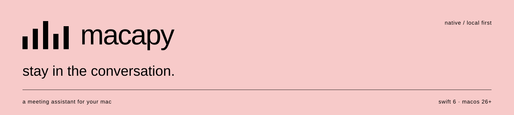
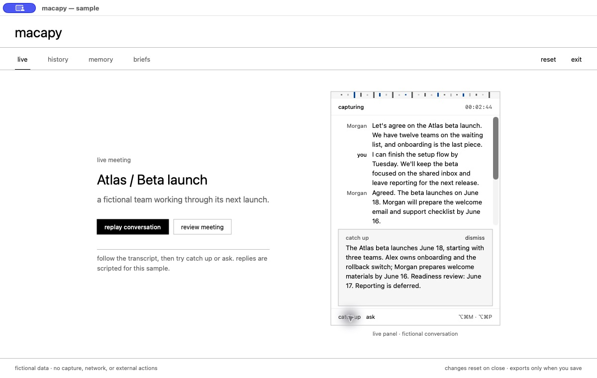
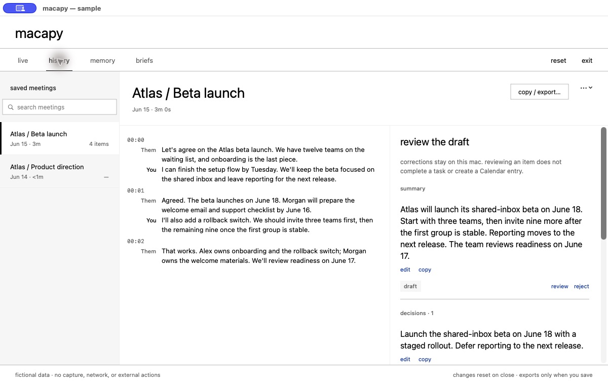
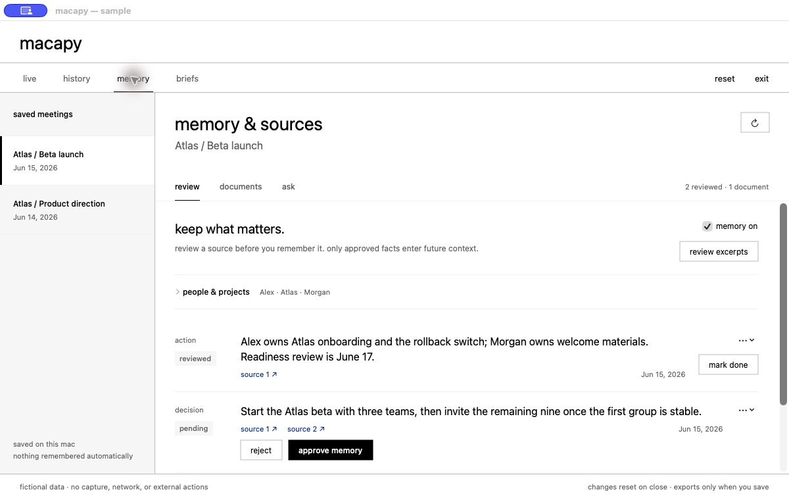
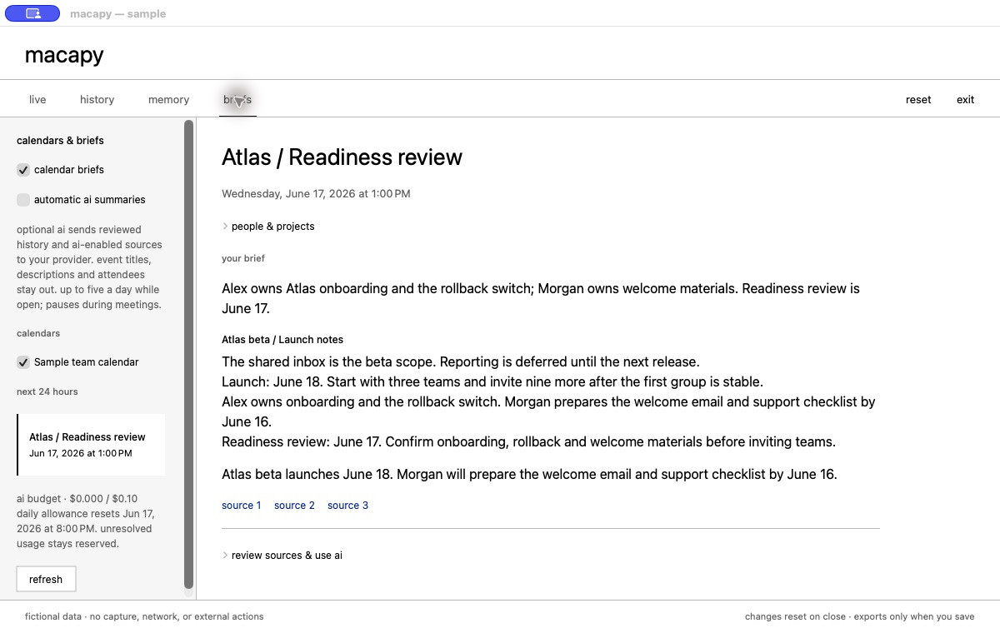
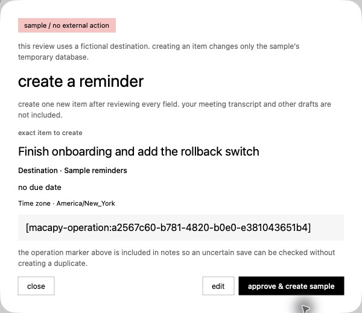
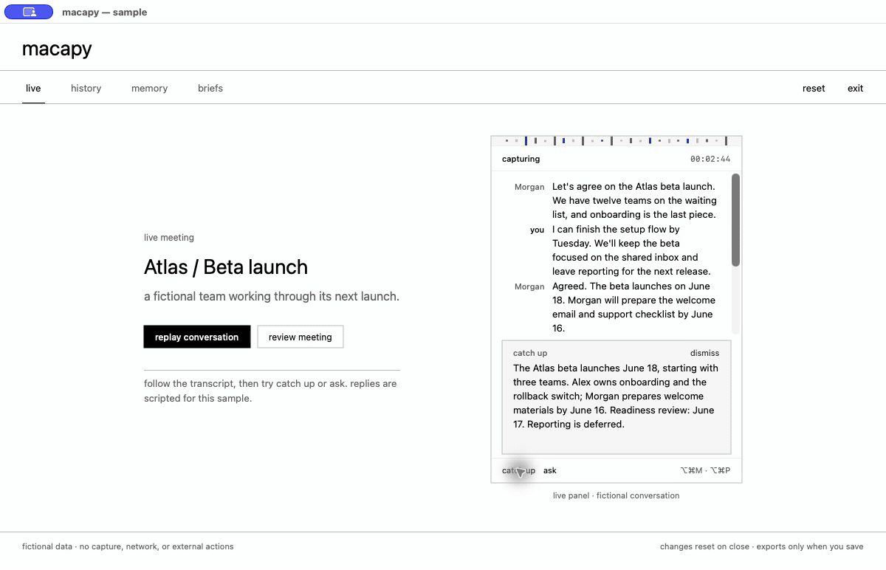

<p align="center">
  
</p>

a local-first meeting assistant for mac. follow the conversation, review what matters, and bring the right context into the next one. built in swift, with on-device transcription and optional ai.

**[watch the tour](media/sample-tour.mp4) · [try it](#try-it) · [inside the architecture](guide/architecture.md)**



*fictional meeting, real interface. the sample runs in memory with scripted ai—no microphone, downloads, key, or external actions.*

## a little more present

- **listen.** local microphone and system-audio transcription in a small floating panel. pause anytime, or keep a meeting ephemeral.
- **catch up.** ask about the conversation or get a quick recap. capture keeps going when optional ai fails or reaches its spend cap.
- **review.** correct summaries, decisions, and actions. track completion, search history, and export useful notes.
- **remember.** keep reviewed, source-linked facts. add documents, inspect the evidence, and choose what ai can use.
- **prepare.** build a brief from your history. review the exact fields before creating a calendar event or reminder.



<details>
<summary><strong>see memory, briefs, and action review</strong></summary>

keep context you can trace.



arrive with a little context.



you approve the exact next step.



</details>

<details>
<summary><strong>play the 48-second visual tour</strong></summary>



four actual sample captures, twelve seconds each. a slideshow, not a live performance recording. [mp4 with playback controls](media/sample-tour.mp4) · [capture details](media/README.md)

</details>

## try it

**source preview.** a signed, notarized download is still to come. you'll need apple silicon, macos 26+, and xcode 26+.

```bash
git clone https://github.com/ogngnaoh/macapy.io.git
cd macapy.io
open macapy.xcodeproj
```

run the `macapy` scheme. dependencies resolve on the first build.

choose **sample meeting** from the menu bar, or add `--sample` to the scheme's launch arguments. explore live, history, memory, and briefs without a key or permissions.

for real meetings, finish setup and install english speech support. start with **⌥⌘M**. transcription and history need no ai key; optional ai currently uses deepseek. [setup and limits →](guide/product.md)

## your mac, your context

no accounts, backend, telemetry, or meeting bot. raw audio never leaves memory. speech runs locally after setup; saved text lives in sqlite and keys stay in keychain.

optional ai sends text to your configured endpoint. memory needs opt-in and review. documents start with ai disabled. calendar reading and automatic briefs have separate consent. ephemeral meetings avoid the persistent database, but their live text can still reach ai when enabled. [privacy and deletion →](guide/privacy.md)

## under the hood

one native process. swift 6, structured concurrency, swiftui/appkit, speechanalyzer, eventkit, and sqlite/fts5.

| promise | design |
|---|---|
| capture keeps going | bounded fan-out, isolated optional work, and generation fences |
| ai stays reviewable | strict response validation, typed outputs, and durable spend reservations |
| context stays traceable | atomic document snapshots, bounded retrieval, and source checks before send and display |
| actions need approval | exact-field review, a durable journal, and reconciliation of uncertain saves |

[architecture and tradeoffs](guide/architecture.md) · [synthetic retrieval benchmarks](guide/benchmarks.md)

## build, test, contribute

```bash
scripts/verify.sh offline
```

source checks, deterministic tests, and the native build. initial dependency resolution may need a network connection. live-provider and installed-model tests are separate opt-in lanes.

[development](guide/development.md) · [contributing](CONTRIBUTING.md) · [security](SECURITY.md) · [release preparation](guide/release.md)

made by [hoang ngo](https://github.com/ogngnaoh). [mit license](LICENSE) · [third-party notices](THIRD_PARTY_NOTICES.md)
