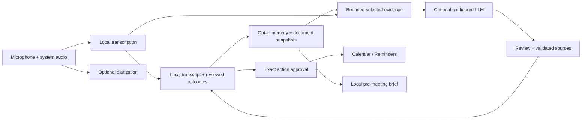

# Architecture

macapy is one native process: a thin Xcode application hosts the root Swift package’s `AppShell` library. SwiftUI and AppKit own presentation; Swift actors and explicitly owned tasks coordinate streaming work. Capture produces local transcript; optional AI turns selected text into reviewed outcomes. Those outcomes can become source-linked memory, explicitly approved external actions, and context for the next meeting.

## Modules and data flow

| Module | Responsibility | Important boundary |
|---|---|---|
| `CaptureKit` | Microphone/system capture, format conversion, bounded audio fan-out | Audio is transient; no persistence or provider dependency. |
| `TranscribeKit` | Apple SpeechAnalyzer adapter, transcript events and store | Uses installed speech assets; local transcription is independent of AI. |
| `DiarizeKit` | FluidAudio adapter and within-meeting speaker attribution | Optional path; no persistence dependency. |
| `PersistKit` | GRDB/SQLite stores, migrations, FTS5 search, edits, exports, spend records | One set of store contracts for disk and in-memory databases. |
| `MemoryKit` | Source/retrieval contracts, local document parsing and chunking, optional embedding adapter | No provider, GRDB, or UI dependency; supported retrieval remains lexical. |
| `ActionKit` | Reviewed action contracts, EventKit adapters, allowlisted calendar snapshots | External writes require a reviewed item; persistence belongs to `PersistKit`. |
| `ProviderKit` | Keychain, endpoint profiles, streaming transport, request inspection, spend metering | Sends text to the configured endpoint; no capture or database ownership. |
| `AgentKit` | Live copilot, artifact/memory extraction, and grounded answers | Optional work with bounded context, cancellation, typed output, and citation validation. |
| `AppShell` | Composition, lifecycle, user controls, native views | Owns meeting/provider identity and prevents stale work from affecting a newer session. |
| `ProviderTestSupport` | Fake provider infrastructure and explicit live-test admission | Test targets only; excluded from production product dependencies. |

Microphone and system audio feed local SpeechAnalyzer instances. Transcript consumers attach before capture starts. Final segments flow to the transcript store and a batched persistence writer; optional diarization adds speaker attribution through separate consumers. AI receives selected text context through `ProviderKit`, never audio. A completed persistent meeting can be extracted into typed draft artifacts, then corrected and reviewed through transactional store APIs.

This is product data flow, not a module import graph. The dependency graph is deliberately small: [GRDB](https://github.com/groue/GRDB.swift) is quarantined in persistence and [FluidAudio](https://github.com/FluidInference/FluidAudio) in diarization. Exact versions and embedded notices are recorded in [Third-party notices](../THIRD_PARTY_NOTICES.md). The root [package manifest](../Package.swift) is the source of truth for build dependencies.

## Capture keeps priority

Optional work must not delay or terminate local capture. Audio fan-out is bounded, and a separate optional diarization worker isolates slow or failed speaker attribution from transcription. Document import and brief synthesis defer during recording. Live Ask source lookup is separately owned optional work; only an explicitly sent selection joins the existing live user-request lease. The coordinator serializes capture activity changes and owns startup, stop, and post-meeting tails explicitly. Stop during preparation cannot later start a stale capture session. Teardown drains or explicitly hands off work before ownership is released.

Actor isolation protects memory access but does not make a sequence spanning `await` atomic. The implementation therefore checks meeting identity, provider generation, and artifact revision at the points where asynchronous results would become visible or durable. Cancellation is useful, but a cancelled dependency can still return; generation checks prevent that result from being applied to a different meeting.

Explore [MeetingPipeline](../Sources/AppShell/MeetingPipeline.swift), [AppShellCoordinator](../Sources/AppShell/AppShellCoordinator.swift), and [pipeline tests](../Tests/AppShellTests/MeetingPipelineTests.swift).

## Provider output is a protocol, not just a string

Endpoint quirks live in profiles behind one OpenAI-compatible transport. Streaming output must satisfy terminal-protocol and natural-stop requirements before structured results are accepted. Partial or truncated JSON is a failure, not a draft to silently persist. Provider errors shown to users are sanitized.

Spend admission reserves an estimated cost before dispatch and settles usage into a ledger. Live and saved-meeting AI share the source meeting budget. Durable reservations distinguish prepared, dispatched, settled, and uncertain attempts: relaunch cancels never-dispatched work and retains a conservative hold for uncertain dispatches. A source/lifecycle validator runs again after admission waits, immediately before transport. Hitting the cap halts optional AI while capture continues.

Briefs use a separate durable daily budget and automatic-generation count, including duplicate/debounce guards. The budget date is a fixed UTC boundary; a backwards clock does not reset it. Content deletion strips source/job identifiers but preserves aggregate cost and unknown commitments. Rates and provider-reported token usage are inputs to an estimate, so displayed cost is not a billing guarantee. Only DeepSeek is currently wired into the app; unused profiles are not a multi-provider support claim.

The request inspector retains exact encoded JSON bodies in a bounded memory-only ring, excluding headers and responses. Its generation fence prevents work from repopulating a cleared inspection history. See [OpenAICompatibleClient](../Sources/ProviderKit/OpenAICompatibleClient.swift), [RequestInspector](../Sources/ProviderKit/RequestInspector.swift), and [provider tests](../Tests/ProviderKitTests).

## Evidence stays attached to its source

Memory is opt-in per completed persistent meeting. Extraction accepts only selected literal source IDs and creates candidates atomically; approval is required before facts enter retrieval. Edits use optimistic revisions. Source references bind to transcript segments, artifact revisions, or document chunks. Store validation and database triggers invalidate derived facts when evidence changes, is removed, or loses eligibility. People/projects and aliases are explicit records, with collision handling and deliberate merges rather than fuzzy identity inference.

Documents are local text snapshots, not remote URLs or filesystem watchers. Parsing and chunking finish before a short transaction publishes the snapshot, chunks, and FTS generation together. Failed reimport rolls back to the preceding generation. AI eligibility starts off; shared snapshots keep meeting attachments, and their last detach removes the snapshot. The parser bounds bytes, extracted characters, pages, and chunks. It does not run OCR or execute embedded content.

The production retrieval path is lexical FTS with source/entity/as-of filters applied before ranking. General context is bounded to eight excerpts and 8,000 characters; optional live grounding splits that allowance into four saved excerpts and four literal recent-turn excerpts. The UI previews those selections before sending. Generated answers accept only citation IDs from that bundle, and eligibility is checked before dispatch and display. An empty evidence set produces a local insufficient-evidence result without a provider call. The optional NaturalLanguage embedding adapter is not enabled as a production semantic-quality claim.

Explore [MemoryRetrieval](../Sources/PersistKit/MemoryRetrieval.swift), [DocumentStore](../Sources/PersistKit/DocumentStore.swift), [GroundedAnswer](../Sources/AgentKit/GroundedAnswer.swift), [LiveQueryGrounding](../Sources/AgentKit/LiveQueryGrounding.swift), and [live source tests](../Tests/AppShellTests/LiveAskSourcesTests.swift).

## External actions and future meetings have separate consent

An action starts from an edited item, passes through exact-field review, and receives explicit approval before EventKit creates anything. The journal records approval and dispatch intent before the external write. If the outcome is uncertain, retries are blocked until reconciliation searches for the reviewed operation marker. This cannot make EventKit and SQLite one transaction; it makes the uncertainty visible instead of assuming failure and creating a duplicate. Calendar actions create one event, Reminder actions create one task, and neither updates/deletes existing items or sends invitations.

Briefs read only selected calendars after read permission. Their event snapshot excludes descriptions, attendees, locations, and URLs. People/project associations are explicit; changing a recurring occurrence, its association, or its evidence invalidates the cached brief. Local source-linked briefs need no provider. Manual synthesis sends the selected evidence and only includes an event title when explicitly selected. Separately enabled automatic synthesis excludes calendar content, operates while the app is open, and defers during capture. Event-owned state and a separate brief budget avoid manufacturing synthetic meetings for billing or persistence.

Explore [ActionReviewModel](../Sources/AppShell/ActionReviewModel.swift), [ActionJournalStore](../Sources/PersistKit/ActionJournalStore.swift), [BriefStore](../Sources/PersistKit/BriefStore.swift), and [BriefWorkspaceModel](../Sources/AppShell/BriefWorkspaceModel.swift).

## Local data has explicit lifetimes

Persistent meetings use SQLite with forward-only migrations and FTS5 indexes. Ephemeral meetings create a private in-memory database through the same store APIs; they do not write to disk and delete afterward. Speaker labels and optional speaker embeddings are meeting data. Settings and Keychain credentials have separate lifetimes from meeting content.

Artifact edits carry the revision originally displayed by the editor. A competing change produces a conflict instead of silently overwriting newer content. Editing resets review as appropriate, and action completion remains separate from approval. Export snapshots are read consistently and written only after an explicit user action.

An interrupted meeting is recoverable only as far as committed transcript. Relaunch marks interrupted records and does not automatically repeat provider extraction. Storage failures expose a warning while capture continues with a bounded text backlog; there is no raw-audio recovery file. Audio-route changes, sleep, and interruptions stop the session explicitly. Quit waits for teardown; a delayed teardown cancels quitting instead of abandoning the tail.

Forward migrations use a consistent SQLite pre-migration snapshot and run database/foreign-key checks. Successful migration removes the snapshot; a failed attempt may retain it temporarily. Content deletion and source revocation purge that app-managed snapshot first so it cannot resurrect deleted content. Deletion removes corresponding searchable content, clears visible optional context, and fences outstanding work. It does not promise physical secure erasure, remove user-created exports, or undo approved external actions.

Explore [ArtifactStore](../Sources/PersistKit/ArtifactStore.swift), [MeetingExport](../Sources/PersistKit/MeetingExport.swift), [recovery tests](../Tests/PersistKitTests/RecoveryTests.swift), and [artifact editing tests](../Tests/PersistKitTests/ArtifactEditingTests.swift).

## A real interface with a reproducible sample

The sample uses the production views and store interfaces with fictional records in an in-memory database. Its copilot and grounded answers are scripted, and its calendar/action adapters are fake. Live, History, Memory, and Briefs share that isolated composition. Direct `--sample` launch avoids production coordinator construction, permission requests, credentials, and model clients. This makes UI review and screenshots reproducible without turning sample output into performance evidence.

The design uses flat neutral surfaces, square controls, hairline structure, and restrained pink/cobalt accents. System fonts, explicit labels, and readable contrast support native presentation in both appearances. [SampleSession](../Sources/AppShell/SampleSession.swift) owns the isolated composition; [sample tests](../Tests/AppShellTests/SampleSessionTests.swift) exercise its data lifecycle.

## Verification and limits

Deterministic tests exercise stores, protocol parsing, race fences, cancellation, and fake-engine behavior. Installed-model and live-provider suites are separate opt-in lanes, so a passing offline suite does not prove speech quality or a provider’s current behavior. The [development guide](development.md) records the commands and evidence boundaries. No universal latency, accuracy, production-scale, or zero-retention-provider claim is made here.
